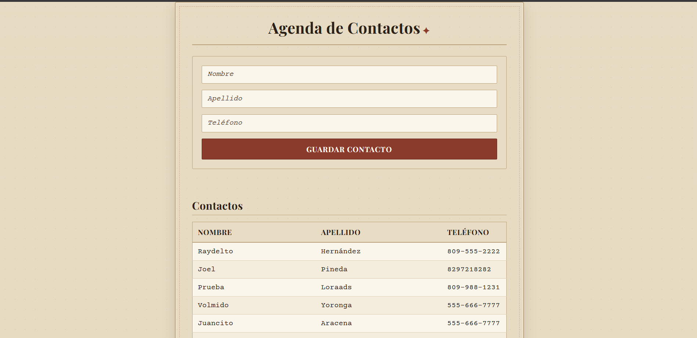

# Agenda de Contactos - Servicio Web con Express

Servicio Web desarrollado con Node.js y Express que permite listar y almacenar contactos conectándose al servicio remoto `http://www.raydelto.org/agenda.php`, acompañado de una interfaz web con estilo vintage.

Autor: Edwin Rondon (2024-1870)

---
## Vista previa


---

## Tecnologías utilizadas

- Node.js y Express (Backend y consumo de API)
- HTML5, CSS3 y JavaScript (Interfaz web)
- Visual Studio Code (Entorno de desarrollo)

---

## Estructura del proyecto

```text
agenda-express/
├── public/
│   ├── index.html
│   └── styles.css
├── .gitignore
├── index.js
├── package.json
└── README.md# agenda-express
